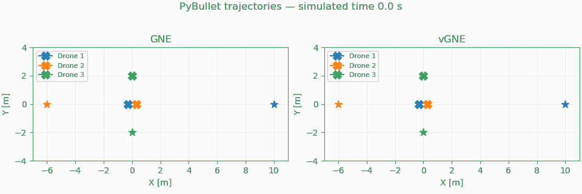

# Game-theoretic MPC — article edition 1.0.0

Reference implementation for **[A Game-Theoretic MPC Planner for Cooperative and Adversarial Drone Coordination](https://arxiv.org/abs/2611.12226)** by Zdeněk Bouček and Miroslav Flídr (2026).

The paper is available as an arXiv preprint ([DOI: 10.48550/arXiv.2611.12226](https://doi.org/10.48550/arXiv.2611.12226)). It has been submitted to the European Control Conference (ECC 2027) and is awaiting reviews.



Animation of the article's cooperative **PyBullet trajectories**: the first eight seconds of **simulated time**, at 10 frames/s. [Full MP4](media/cooperative.mp4). Physics pauses while a plan is solved.

The main package contains the planners, five editable study configurations, examples, and compact numerical inputs for the article figures and table. Complete solver attempts and audit evidence for these five studies are a **separate dataset**, prepared for Zenodo. Code is MIT; data and visualizations are CC BY 4.0.

Use Python 3.11 on CPU, from this extracted directory:

```bash
python -m venv .venv
source .venv/bin/activate
pip install -r requirements/core.txt
python -m game_theory_mpc figures
python -m game_theory_mpc tables
```

Run your own experiment:

```bash
cp configs/cooperative.toml my-flight.toml
# Edit targets, weights, bounds, blocks or execution.updates.
python -m game_theory_mpc run --config my-flight.toml --output outputs/my-flight
```

For PyBullet flights, install `pip install -r requirements/reproduction.txt`; the pinned simulator wheel is included. Set `execution.plant = "nominal"` to run without a simulator. `python -m game_theory_mpc quick` runs short smoke checks. Installation is editable, so Python changes take effect on the next run. Existing output directories are rejected.

Full independent numerical verification uses the optional dataset **without unpacking it yourself**:

```bash
python -m game_theory_mpc verify --audit-data ../release-game-theory-mpc-article-data-1.0.0.tar.xz
```

See [dataset availability and proposed Zenodo metadata](zenodo/README.md). The dataset has been prepared locally; a Zenodo DOI has not yet been assigned. Figures/tables use compact numeric inputs and archived summaries; they do not claim to repeat the complete solver audit. Custom experiments do not require the reference dataset.

Continue with [development and configuration](docs/DEVELOPMENT.md), [article-to-code map](docs/CODE_MAP.md), [controller APIs](docs/API.md), [data formats](docs/DATA.md), and [verification](REPRODUCIBILITY.md). Four short [examples](examples/) use the article methods. Regenerate the GIF without FFmpeg or another solve: `python -m tools.animate --source data/reference.zip --output outputs/cooperative.gif`.

## Citation

If you use this framework, its data or its results in scientific work, please cite the preprint:

```bibtex
@misc{boucek2026gametheoreticmpc,
  title         = {A Game-Theoretic {MPC} Planner for Cooperative and Adversarial Drone Coordination},
  author        = {Bouček, Zdeněk and Flídr, Miroslav},
  year          = {2026},
  eprint        = {2611.12226},
  archivePrefix = {arXiv},
  primaryClass  = {cs.RO},
  doi           = {10.48550/arXiv.2611.12226},
  url           = {https://arxiv.org/abs/2611.12226}
}
```

[CITATION.cff](CITATION.cff) supplies the paper and software citation metadata for GitHub's **Cite this repository** feature. Cite the software separately to identify the version used, and credit [NashOpt and gym-pybullet-drones](THIRD_PARTY_NOTICES.md) where used.
